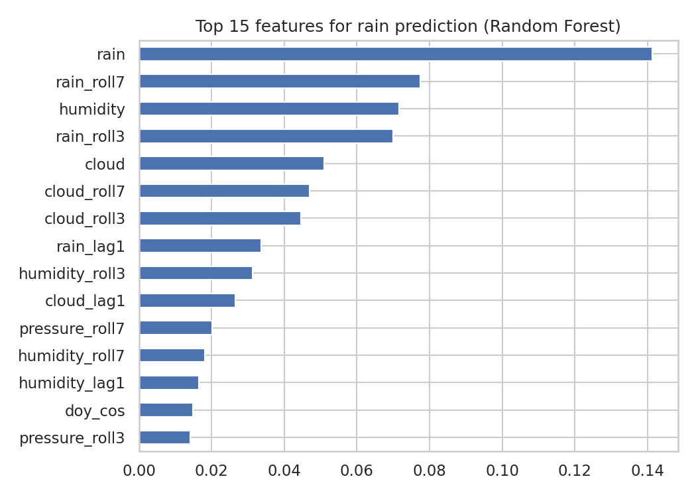
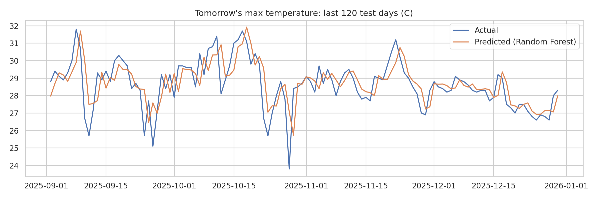

## Weather Prediction for Hyderabad

I made this project to learn how machine learning works on real weather data. It does two things:

1. Predicts if it will rain tomorrow (yes or no).
2. Predicts tomorrow's highest temperature.

You can run the whole thing on Google Colab: [Open the notebook in Colab](https://colab.research.google.com/github/Nithishh2026/Weather-prediction/blob/main/notebooks/weather_prediction.ipynb)

## About the data

I got the data from [Open-Meteo](https://open-meteo.com/). It is free and you do not need to sign up. I downloaded hourly weather for Hyderabad from 2015 to 2025 and turned it into daily data.

The data has temperature, humidity, rain, air pressure, wind and cloud cover. I counted a day as rainy if it had 1 mm or more of rain. About 30 out of every 100 days were rainy.

## What I did

1. Downloaded the data and made it daily.
2. Checked for missing values and filled the small gaps.
3. Made charts to understand the data. They are in the `outputs` folder.
4. Made new columns from the data, like the last 3 days' values, 3 day and 7 day averages, the change in pressure, and the time of year.
5. Split the data by date. I trained on 2015 to 2022 and tested on 2023 to 2025. I did not mix the dates, because then the model would see the future.
6. Made a simple baseline: "tomorrow will be the same as today". A model is only useful if it does better than this.
7. Trained three models: Logistic Regression (Ridge for temperature), Random Forest and Gradient Boosting.
8. Compared all of them on the test years.

## Results

**Will it rain tomorrow?**

| Model | Accuracy | Precision | Recall | F1 | ROC-AUC |
|---|---|---|---|---|---|
| Baseline (same as today) | 0.834 | 0.749 | 0.749 | 0.749 | - |
| Logistic Regression | 0.826 | 0.684 | 0.878 | 0.769 | 0.921 |
| Random Forest | 0.855 | 0.762 | 0.815 | 0.788 | 0.920 |
| Gradient Boosting | 0.839 | 0.731 | 0.812 | 0.770 | 0.919 |

**Tomorrow's highest temperature**

| Model | MAE (°C) | RMSE (°C) | R2 |
|---|---|---|---|
| Baseline (same as today) | 0.882 | 1.233 | 0.867 |
| Ridge Regression | 0.876 | 1.164 | 0.882 |
| Random Forest | 0.864 | 1.172 | 0.880 |
| Gradient Boosting | 0.870 | 1.171 | 0.880 |

What I saw:

- For rain, Random Forest did best. Its F1 score was 0.788, and the baseline was 0.749.
- Logistic Regression found the most rainy days (recall 0.878), but it also gave more wrong rain alarms (precision 0.684).
- For temperature, the models were only a little better than the baseline. The average error went from 0.882 °C to 0.864 °C. This is because tomorrow's highest temperature is usually close to today's.
- The rain baseline is also strong, because rain in Hyderabad comes in spells during the monsoon.
- I also tested Random Forest on 5 different time periods. The average F1 was 0.771, so the result is not just luck from one test period.




## What I learned

- For weather data, always split by time. A random split gives scores that look better than they really are.
- Always compare with a simple baseline. Without it, the numbers do not mean much.
- Accuracy alone is not enough for rain, because there are more dry days than rainy days. F1 and recall tell more.
- A bigger model is not always much better.

## Limits

- It uses one city only.
- The data is daily, so short storms are hard to catch.
- I used one main test period (2023 to 2025).
- It is not as good as real forecasts from IMD, which use satellites and weather physics.

## What I want to try next

- Add data from nearby cities.
- Try an LSTM model and compare it with Random Forest.
- Make a small web app where you enter today's weather and get a prediction.

## How to run

Easiest way: open the notebook in Colab (link at the top) and click Runtime, then Run all. It downloads the data by itself and takes a few minutes.

To run on your own computer:

```bash
git clone https://github.com/Nithishh2026/Weather-prediction.git
cd Weather-prediction
pip install -r requirements.txt
jupyter notebook notebooks/weather_prediction.ipynb
```

The notebook makes `data`, `outputs` and `models` folders next to itself when it runs.

## Folders

- `notebooks` has the main notebook with all the code.
- `outputs` has the charts and the result tables (CSV files).
- `requirements.txt` lists the Python libraries I used.

## Note

Weather data is from Open-Meteo. Please read their terms before using it for anything else. I used an AI assistant to help me while I was learning and writing parts of the code.
